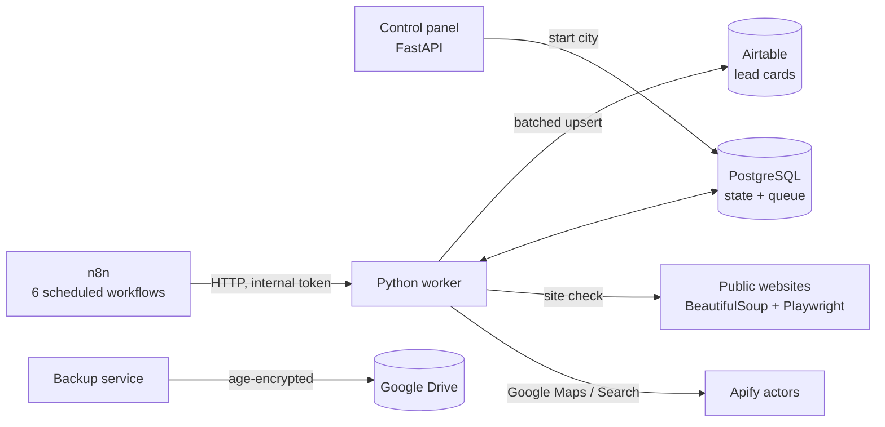

# Local Lead Finder (n8n + Python)

A self-hosted system that finds independent pizzerias, kebab shops, burger bars and fast-food places in a chosen Spanish town. For each place it checks whether the business already has its own online ordering, scores it as a sales lead, and syncs the qualified leads to Airtable.

It was built for my studio, Cortex Studio, which sells ordering websites to local restaurants. The first area it covered was Gandia, Grau and Platja de Gandia.

## How it works



1. **Discovery.** For each city it searches Google Maps through Apify zone by zone (bounding boxes from `config/cities.json`). The primary key is the Google Place ID. When that is missing it falls back to name + phone + address, and every branch is kept as its own record.
2. **Enrichment.** It visits the public website and looks for the restaurant's own cart or checkout. Glovo, Just Eat or plain WhatsApp ordering still counts as "no own ordering". When a check cannot finish, the result stays `unknown` and is never turned into a negative.
3. **Scoring.** A = confirmed delivery or pickup, a phone number and no website. B = has a website but no own ordering. C = needs a manual check.
4. **Sync.** Changed records go to Airtable in batches of 10. The fields the salesperson owns (status, next contact, notes) are never overwritten.

n8n handles scheduling, retries and error alerts. The business logic lives in the Python worker, where it is unit-tested.

## Safety and cost guards

- **Apify budget.** Before every run the worker checks the plan, the real remaining credit and the actor's minimum run cost. It enforces a monthly cap, a reserve and a per-run limit of $0.50 / 900 s. If the quota can't be verified, new runs are blocked.
- **No blind retries.** A lost run response is matched against existing run IDs instead of sending a second POST.
- **Pilot first.** The first pass of a city is limited to 20 checks and needs explicit approval before the full pass.
- **Airtable quota.** Record and monthly API-call ceilings are enforced. When the quota runs out, the queue is kept so nothing is lost.
- **Honest coverage.** A district is only marked complete when it has no errors, no partial passes and no unchecked candidates.
- **Local only.** The panel and the worker listen on 127.0.0.1. Secrets are generated locally by `scripts/bootstrap.py` and never committed.
- **Encrypted backups.** The databases are encrypted with `age` before upload. The Drive scope is `drive.file` only, with 7 daily and 4 weekly copies. `scripts/restore_check.py` verifies an archive in a throwaway project.

## Stack

n8n · Python 3 · FastAPI · Jinja2 · PostgreSQL 17 · BeautifulSoup · Playwright · Apify · Airtable API · Docker Compose · age · rclone · pytest

## Project structure

```
app/          worker: pipeline, scoring rules, website inspector, Airtable/Apify clients, control panel
workflows/    the six n8n workflows (control, discovery, enrichment, Airtable sync, maintenance, errors)
config/       cities with search zones, budgets and limits
scripts/      bootstrap secrets, import workflows into n8n, coverage report, backup setup and restore check
backup/       encrypted backup service and its test
tests/        pytest: scoring rules, state machine, safety limits
```

## Running it

You need Docker with Compose and an existing n8n instance on the same Docker network.

```sh
python3 scripts/bootstrap.py          # generate local secrets (.env, .secrets/)
docker compose build && docker compose up -d
python3 scripts/setup_n8n.py          # import the six workflows, inactive
```

Then open http://localhost:5680/connections, add your Apify token and Airtable PAT, and set your base and table in `config/settings.json`.

Run the tests:

```sh
docker compose run --rm -v "$PWD/tests:/app/tests:ro" worker python -m pytest -q
```

The UI and the status messages are in Ukrainian.

## License

© 2026 Andrii (Cortex Studio). All rights reserved. The source is published as a portfolio sample.
